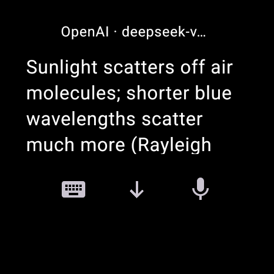
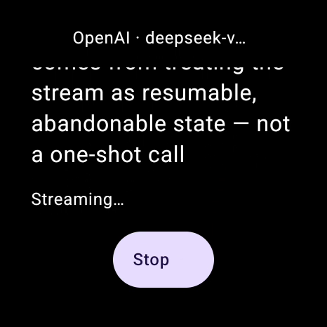
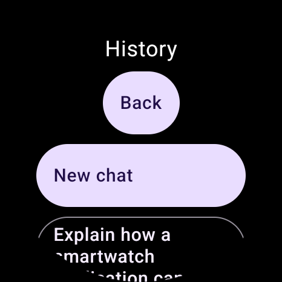

<div align="center">


# NiroWear

**Ask on your watch. Read beyond one screen.**

NiroWear brings AI chat to Wear OS: type or dictate a question, read the answer as it arrives, and return to the full conversation later.

**Public beta · 0.1.0-beta.1 · Sideload only**

[**Download Beta · APK**](https://github.com/michaelxdips/NiroWear-Beta/releases/download/v0.1.0-beta.1/NiroWear-0.1.0-beta.1.apk) · [Release notes](https://github.com/michaelxdips/NiroWear-Beta/releases/tag/v0.1.0-beta.1) · [Install guide](docs/USER_GUIDE.md#install-the-apk)

**Bring your own API key.** Generation needs internet access and may incur provider charges; no API credit is included.

<a href="#read-the-answer-not-a-miniature-desktop"></a>

One view into a real answer—not the whole answer squeezed onto your wrist.

</div>

## Find your way

| Explore the experience | Get started or help |
|---|---|
| [Before, during, and after an answer](#a-question-does-not-end-at-one-screen) | [Download and install](#download-and-install) |
| [Choose an API and model](#choose-your-api-and-model) · [Keyboard and voice](#ask-with-keyboard-or-voice) | [Step-by-step user guide](docs/USER_GUIDE.md) |
| [Streaming, Stop, and Latest](#read-while-the-answer-arrives) · [Formatted answers](#read-the-answer-not-a-miniature-desktop) | [Troubleshooting and FAQ](docs/TROUBLESHOOTING.md) |
| [Retry and edit](#change-the-answer-or-the-question) · [History and switching](#return-to-a-conversation-or-start-fresh) | [Help improve NiroWear](#help-improve-nirowear) · [Beta limits](#limitations-worth-knowing) |

## A question does not end at one screen

Start with a question, pause to inspect the answer, then come back when you need it. NiroWear treats assistant output as a document to read—not an oversized chat bubble.

<table>
  <tr>
    <td align="center"><a href="#ask-with-keyboard-or-voice"></a><br /><strong>1. Before: ask</strong><br />Keyboard opens Prompt.<br />Review text, then Send.</td>
    <td align="center"><a href="#read-while-the-answer-arrives"></a><br /><strong>2. During: read</strong><br />Follow incoming text.<br />Stop keeps received text.</td>
  </tr>
  <tr>
    <td align="center"><a href="#read-the-answer-not-a-miniature-desktop"></a><br /><strong>3. Pause: inspect</strong><br />Pan through wide code.<br />Read tables as labeled records.</td>
    <td align="center"><a href="#return-to-a-conversation-or-start-fresh"></a><br /><strong>4. After: return</strong><br />Open History.<br />Resume a saved conversation.</td>
  </tr>
</table>

Select a screenshot to jump to its feature guide below. The [table view](#read-the-answer-not-a-miniature-desktop) shows how a grid becomes readable records.

All six screenshots on this page are genuine, uncropped **466 × 466 emulator captures**, displayed smaller for browsing. These views illustrate the workflow, not one continuous recorded chat. Each captures one position, not an entire response. They are not mockups or proof of physical-watch compatibility. Provider screens are capture-protected, so no credential-screen image is included.

## Explore the published beta

Expand a section for controls, examples, and limits. The README covers everyday use; linked guide sections add detailed setup and recovery steps.

### Choose your API and model

<details>
<summary><strong>Your endpoint, your key, your model — setup and switching</strong></summary>

NiroWear connects directly to the HTTPS API endpoint you configure. Tap the top header for **Menu**, then open **Providers / model**. Choose the API supported by your endpoint:

| Add option | Supported generation API |
|---|---|
| **Add OpenAI** | OpenAI Responses |
| **Add Anthropic** | Anthropic Messages |
| **Add Gemini** | Gemini streaming GenerateContent |
| **Add compatible** | OpenAI-compatible Chat Completions |

**Discover models** retrieves a model catalog. Select an appropriate text-generation model, or enter its exact ID in **Manual model ID**. Manual entry remains available when a compatible endpoint cannot list models. Discovery is not a generation test, and a listed model may not support your request.

**Validate · uses API** sends a small generation request and may incur charges. **Save securely** saves and selects the profile; saving a new profile alone does not prove generation works. Enter the documented API base, not a full request URL.

**Provider/model switching:** while idle, select another saved profile, or use **Edit / replace key** to change its model and **Save securely**. The conversation stays linear; older assistant messages keep their original provider/model labels. See [context sharing](#return-to-a-conversation-or-start-fresh) before sending to a different endpoint.

**Key storage:** entry is masked. Saved keys use Android Keystore-backed AES-GCM encryption, and the editor never repopulates a saved key. Leave **API key** blank to retain it. Replacing a key requires **Validate · uses API**, followed by another validation during save; both requests may cost money. Secure-storage failure requires re-entry, with no plaintext fallback.

Choose protocols from endpoint documentation, not model names. A familiar model name does not establish who operates an endpoint. Live coverage across all four upstream services is incomplete.

[Provider setup and base URLs](docs/USER_GUIDE.md#add-your-first-provider) · [Saved-key replacement](docs/USER_GUIDE.md#saved-keys-and-replacement)

</details>

### Ask with keyboard or voice

<details>
<summary><strong>Two entry points, one editable Prompt before Send</strong></summary>

**Keyboard:** tap the keyboard icon, labeled **Keyboard input** for accessibility. On **Prompt**, tap the field, type with your installed Wear keyboard, and tap **Send**.

**Voice handoff:** tap the microphone icon, labeled **Voice input**. The system speech recognizer handles speech. If it returns text, NiroWear opens **Prompt** for review or correction. Speech is not automatically sent to the AI provider; tap **Send** when ready.

Start with a small nonconfidential question:

```text
Explain why the sky is blue in three sentences.
```

Then ask `Explain that in more detail, with one example.` The conversation supplies context. Answers are concise by default, but you can request depth, steps, comparisons, or complete code. Long output stays scrollable rather than being squeezed into a single screen; length and quality depend on the model.

Voice recognition depends on installed services, permissions, and their processing policies. Genuine spoken transcription has not been fully verified. Keyboard remains available if recognition is missing or blocked.

[First keyboard message](docs/USER_GUIDE.md#send-your-first-message) · [Voice steps](docs/USER_GUIDE.md#voice-input) · [Before-you-ask screenshot](#a-question-does-not-end-at-one-screen)

</details>

### Read while the answer arrives

<details>
<summary><strong>Streaming, Stop, and Latest — keep control of your reading</strong></summary>

**Streaming:** text appears incrementally. Near the bottom, the reader follows incoming content so you can read along.

**Latest:** scroll upward to revisit earlier paragraphs without being pulled back down. The down-arrow action, labeled **Jump to latest** for accessibility, returns to the current tail. It is an icon, not a text button.

**Stop:** tap **Stop** during generation to cancel the underlying client request. Received partial text stays visible with stopped status. Wait for the request to settle before another send or provider switch. Failed or interrupted streams are not automatically replayed.

For example, ask for a longer explanation, scroll back to its first section while it streams, then use **Latest** when ready to catch up. You do not need to discard the answer to stop waiting for more.

**Stop cannot guarantee that the provider stops remote computation or billing.** Sending again or choosing Retry makes a new, potentially billable request.

[Streaming controls](docs/USER_GUIDE.md#read-a-streaming-answer) · [Streaming screenshot](#a-question-does-not-end-at-one-screen)

</details>

### Read the answer, not a miniature desktop

<a href="docs/USER_GUIDE.md#tables"></a>

<details>
<summary><strong>Markdown, Unicode, code, tables, math source, and links</strong></summary>

**Markdown:** headings, paragraphs, bullet and numbered lists, quotes, emphasis, inline code, and dividers give an answer structure. Scroll through the document rather than opening a large message bubble.

**Unicode:** Greek letters, mathematical symbols, and other scripts use device fonts. Coverage varies; unsupported glyphs may appear as boxes.

**Code:** fenced blocks preserve formatting in monospace, with a language label when supplied. Pan horizontally inside wide blocks, then scroll vertically through surrounding explanation. A rightward swipe at the block's left edge may invoke Wear OS back/dismiss; reopen the conversation through History if you leave it.

**Tables:** a Markdown table becomes vertical records. Each row's values appear under their column labels, keeping the relationships readable without a tiny desktop grid.

Try a small comparison:

```text
Compare walking and cycling in a Markdown table with columns Activity,
Equipment, and One benefit. Use two rows.
```

**Math source, not typeset formulas:** the published beta displays Unicode and readable LaTeX source. Fractions, roots, powers/subscripts, calculus, matrices, cases, and aligned equations remain source text; wide formula source supports horizontal pan. Seeing `\frac{...}{...}` or `\begin{matrix}...\end{matrix}` is expected. Native formula typesetting is unavailable.

**Links:** tap an HTTP(S) link to request an external Android/Wear handler. There is no built-in browser. Reaching the destination depends on watch/phone handlers and permissions; complete external handoff has not been fully verified.

Reader, font, table, and horizontal-pan checks on the published APK are incomplete; screenshots show particular views, not every possible document.

[Markdown and symbol example](docs/USER_GUIDE.md#markdown-and-unicode) · [Code example and pan guidance](docs/USER_GUIDE.md#code) · [Table example](docs/USER_GUIDE.md#tables) · [Math source example](docs/USER_GUIDE.md#math) · [Link handoff](docs/USER_GUIDE.md#links)

</details>

### Change the answer or the question

<details>
<summary><strong>Retry an answer, or edit a message and replace its continuation</strong></summary>

**Retry response:** while idle, scroll to the circular-arrow icon after the latest assistant response. Tap it to replace that answer with a new request using the currently selected provider/model. Retry starts a new response; it does not resume the cancelled connection or keep alternate versions.

**Edit an earlier user message:** while idle, find and long-press that message to open **Prompt**. Change the wording, review it, then tap **Edit & resend**. For example, change “Compare three options” to “Compare two options and include one drawback for each.”

**Edit & resend replaces the edited message and permanently deletes every later message in that conversation before generating a new continuation. There is no branch or undo copy. Use Back to cancel before committing. Removing local text does not remove copies already held by a provider.**

Retry and edit/resend are explicit new API requests and may incur charges. Choose **New chat** instead if you want to keep the old conversation intact and ask a separate question.

[Retry steps](docs/USER_GUIDE.md#retry-the-latest-assistant-response) · [Edit steps and consequences](docs/USER_GUIDE.md#edit-an-earlier-user-message)

</details>

### Return to a conversation or start fresh

<details>
<summary><strong>Local History, New chat, and what changes when you switch providers</strong></summary>

**History:** tap the top header for **Menu**, choose **History**, and tap a conversation title. Saved user messages and assistant answers—including original Markdown and stopped partial text—stay on the device. You can read saved history without generating a new answer; generation still needs internet access. Exact reading-position restoration is not a blanket guarantee.

**New chat:** while idle, choose **New chat** in Menu or History. It starts a separate conversation without deleting existing ones. Use it for a new topic or before contacting a different endpoint when you do not want to send the old context there.

**Switching with context:** choosing another provider/model does not erase or branch the current conversation. Earlier assistant messages keep their original provider/model labels. Sending after a switch shares the retained conversation context with the newly selected endpoint.

**Privacy:** your key and requested context go directly to that endpoint. Its operator controls processing, retention, and charges. There is no separate NiroWear relay or account, no configured analytics or crash-reporting SDK, and no NiroWear cloud backup. System voice processing follows the recognizer's policies.

Conversation text is not separately encrypted. This beta has no user-facing history export or conversation deletion control. **Uninstalling or clearing app data can permanently remove history, settings, and access to stored keys.**

[History and switching steps](docs/USER_GUIDE.md#history-new-chats-and-provider-switching) · [Privacy details](PRIVACY.md) · [History screenshot](#a-question-does-not-end-at-one-screen)

</details>

## Download and install

The current published release is **0.1.0-beta.1**, published **2026-10-10**. Download the APK, not GitHub's automatic source archives: those contain public landing files, not buildable application source.

GitHub may show only “1 tag” in the repository sidebar for this prerelease. The published beta and APK are available through **Download Beta** above; no stable `/releases/latest` link is required. [Details](docs/TROUBLESHOOTING.md#why-does-the-repository-sidebar-say-releases--1-tag).

Minimum: **Wear OS 3 or newer with Android API 30 or newer**. The reference evaluation setup is a round **466 × 466 Wear OS 5 / API 34 emulator**. Minimum requirements are not a tested-device list; broad physical-watch support is unverified. No Play Store release is available.

| Published APK identity | Value |
|---|---|
| Download | [NiroWear-0.1.0-beta.1.apk](https://github.com/michaelxdips/NiroWear-Beta/releases/download/v0.1.0-beta.1/NiroWear-0.1.0-beta.1.apk) |
| Package | `com.nirowear` |
| Version / versionCode | `0.1.0-beta.1` / `2` |
| Size | 25,994,739 bytes |
| SHA256 | `25b091753743c5b439bb1413525ddef9f69a28d81bd7dae9773013e32605fdb7` |
| Signing certificate SHA256 | `7d4e6e99821d904f23900bd4e0cad5b64b1a2733a28243dcc8ab9d6e2768abe3` |

**Signing caution:** this nondebuggable APK uses an owner-approved Android Debug certificate as its beta update identity. That is not production-grade signing. See [security guidance](SECURITY.md).

1. Download the APK and verify its SHA256 against the value above.
2. Pair/connect Android SDK Platform Tools with your intended watch using its supported debugging workflow.
3. Check `adb devices -l`, then install with `adb -s <serial> install NiroWear-0.1.0-beta.1.apk`.
4. Open NiroWear, tap the top header for **Menu**, and open **Providers / model**.
5. Add the correct provider type, HTTPS API base, key, and model ID. Choose **Save securely**, return with **Back**, then use the keyboard icon to send a first prompt.

The [user guide](docs/USER_GUIDE.md#install-the-apk) includes checksum, pairing, and same-certificate update steps. Continue with [provider setup](docs/USER_GUIDE.md#add-your-first-provider) and [your first message](docs/USER_GUIDE.md#send-your-first-message).

**Do not uninstall or clear app data to bypass a signing mismatch.** Doing so can permanently remove conversations, settings, and access to stored keys. There is no user-facing conversation export or deletion control in this beta.

## Limitations worth knowing

This is an evaluation beta, not a production-certified release. What you can use and what has been fully checked are different:

- The published APK has not been fully checked across all reader content, tables, font sizes, restoration cases, and horizontal-pan interactions.
- Physical-watch touch, battery, thermals, accessibility, and broad compatibility are not fully verified. Human visual review of the protected provider editor is incomplete.
- Genuine spoken transcription and complete external-link destinations are not fully verified.
- Broad live upstream coverage is incomplete. Observed genuine requests used a configured third-party HTTPS Responses endpoint; a displayed model/provider name does not prove official upstream identity.
- Native math typesetting is unavailable. Source fallback is the actual published behavior.
- History stays on the device, is not separately encrypted, and has no NiroWear cloud backup. Uninstalling or clearing data can remove it permanently.

See [troubleshooting and FAQ](docs/TROUBLESHOOTING.md) before resetting anything.

## Privacy, safety, and feedback

Before sending private content, review [privacy facts](PRIVACY.md) and your selected endpoint's policies. Keys are encrypted locally; conversation text is not. Switching providers and sending again shares the retained context with the new endpoint.

AI answers can be false, incomplete, or outdated. Check important claims independently. You are responsible for meeting your provider's account, region, age, and use restrictions; availability in the app is not permission to use a service.

**GitHub Issues are public. Never post API keys, authentication headers, pairing codes, private conversations, or unredacted credential-screen captures. Report vulnerabilities through [GitHub private vulnerability reporting](https://github.com/michaelxdips/NiroWear-Beta/security/advisories/new), not public issues.**

## Help improve NiroWear

Good feedback connects a real action to a real result: what you tried, what you expected, and what happened. You can help without application-source access.

| How you can help | Where to go |
|---|---|
| Improve instructions, fix links, or clarify a feature | A focused [public documentation PR](CONTRIBUTING.md#public-pull-requests) |
| Improve existing public repository checks or documentation tooling | A focused [public-tooling PR](CONTRIBUTING.md#public-pull-requests), with its check results |
| Report a reproducible app bug or share a test case | [Bug and feedback forms](https://github.com/michaelxdips/NiroWear-Beta/issues/new/choose) |
| Share physical-watch or emulator observations: readability, font size, touch reachability, input, or accessibility | [Device and accessibility feedback](https://github.com/michaelxdips/NiroWear-Beta/issues/new?template=device-feedback.yml) |
| Propose development or testing work requiring private source | [Owner-reviewed collaboration intake](https://github.com/michaelxdips/NiroWear-Beta/issues/new?template=developer-collaboration.yml) |

For device reports, include the watch model, OS, NiroWear version, relevant display/font settings, and repeatable steps. Say whether you used a physical watch or emulator. Do not spend API credit or reset valuable app data just to finish a report.

Application source is private and proprietary. Collaboration requests are reviewed individually; an issue or PR does not automatically grant source access or permission to redistribute it. Keep public requests nonconfidential; any needed private arrangements are discussed separately by the owner. Read [contribution guidance](CONTRIBUTING.md) before submitting.

## Copyright and notices

Copyright © 2026 Stephen Michael, for first-party NiroWear material. Application source is proprietary and not open-source. Public availability of this distribution/documentation repository does not grant a blanket reuse license. See [COPYRIGHT.md](COPYRIGHT.md).

Third-party components, icons, and other materials retain their respective owners' rights and license terms. See [THIRD_PARTY_NOTICES.md](THIRD_PARTY_NOTICES.md), [SECURITY.md](SECURITY.md), and [published release history](CHANGELOG.md).

The repository uses NiroWear's newly authored [Folded Signal identity](docs/branding/PROVENANCE.md). Historical beta.1 retains its original launcher icon; this presentation change does not replace its APK.
